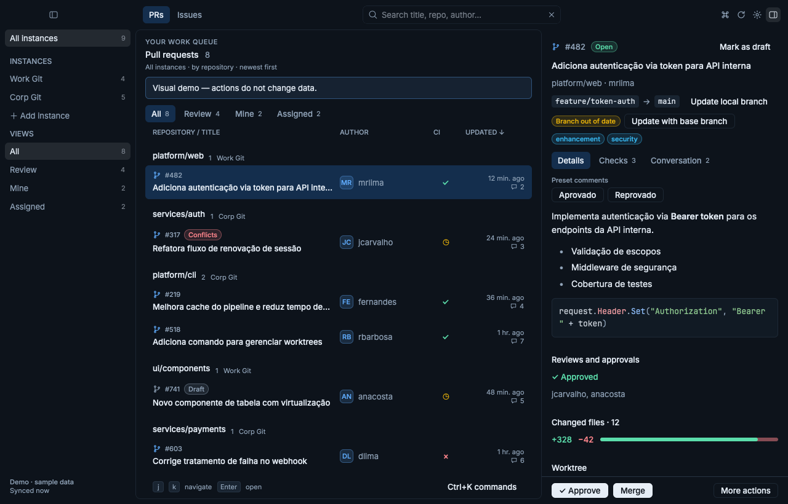
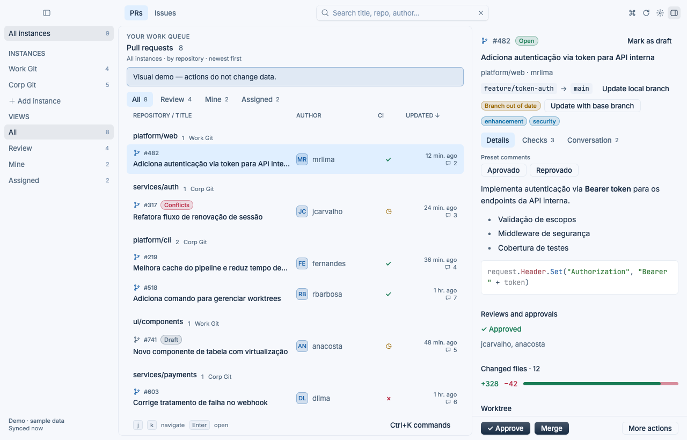
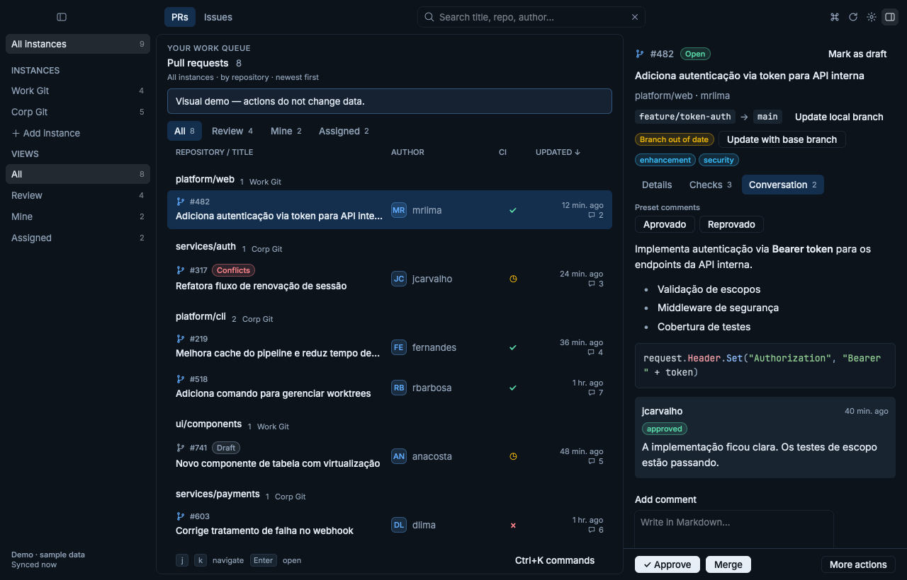
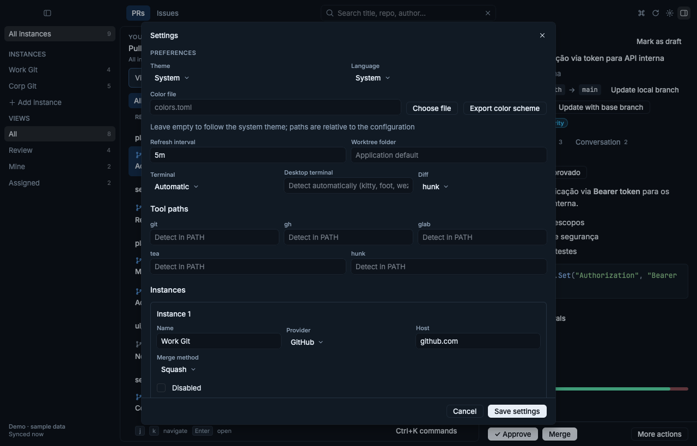

# pr-tracker

A native desktop window for tracking **pull requests** (GitHub, Gitea),
**merge requests** (GitLab), **issues**, and their **comments** across multiple
instances, including self-hosted servers. Communication goes through the
`gh`, `glab`, and `tea` CLIs, using the authentication you already have configured.

pr-tracker is a single Rust binary. With no arguments it opens the window, drawn
with [Rune](https://github.com/anomalyco/rune); with a subcommand (`list`,
`doctor`, `instance`, `repo`, …) it prints to the terminal.

| Dark | Light |
|---|---|
|  |  |
|  |  |

- Switch between **PRs** and **Issues** in the toolbar. PR views: **All**,
  **Review** (review requested from you), **Mine**, and **Assigned**. Issue
  views: **All**, **Assigned**, **Created**, and **Mentions**. The sidebar also
  filters by instance. PRs are grouped by repository.
- The inspector shows the selected item in three tabs: **Details**, **Checks**,
  and **Conversation**. Descriptions and comments are rendered as Markdown. PR
  conversations also include reviews (approved / changes requested) and inline
  comments with `file:line`. Write a comment in the composer below the
  conversation; unsent drafts are kept per item.
- See **pipeline/check status** (success, failure, running, canceled) and jobs,
  alongside reviews, approvals, conflicts, and diff size.
- Refresh automatically at a configurable interval (**5 minutes** by default),
  or immediately with `r`.
- Use the keyboard or mouse. `Ctrl+K` (`⌘K` on macOS) opens a command palette
  that lists the main actions with their shortcuts.
- Check out a PR in an isolated **worktree** or the **configured clone**, then
  approve, merge, or close without merging, optionally removing the worktree.
- Optional integrations: **hunk** for diffs; **herdr** or **tmux** to open a
  terminal or diff in a new tab.
- The interface supports **English** and **Portuguese**, following the computer's
  language by default. Choose a language in settings to override it.

## Requirements

| Tool | Purpose | Required |
|---|---|---|
| `git` | Worktrees and checkout | Yes |
| [`gh`](https://cli.github.com) | GitHub instances (github.com and GHES) | For GitHub |
| [`glab`](https://gitlab.com/gitlab-org/cli) | GitLab instances (gitlab.com and self-hosted) | For GitLab |
| [`tea`](https://gitea.com/gitea/tea) (0.14+) | Gitea instances (gitea.com and self-hosted) | For Gitea |
| [`hunk`](https://github.com/modem-dev/hunk) | View diffs (falls back to `git diff`) | No |
| `herdr` / `tmux` | Open a terminal or diff in a new tab | No |

On Linux the window needs a Vulkan driver. **Settings → Tools and
authentication** and `pr-tracker doctor` list missing tools with an installation
link. See [Gitea support](docs/gitea.md) for what `tea` covers and what requires
direct API calls. See [Bitbucket support](docs/bitbucket.md) for the deferred
integration: Bitbucket has no official CLI.

## Installation

Download an archive from
[releases](https://github.com/vitorpacheco/pr-tracker/releases). Stable releases
are published for `v*` tags; `nightly` is updated on every commit to `main`.
Archives are named `pr-tracker_<version>_<os>_<arch>.tar.gz` (`.zip` on Windows)
and are published for Linux, macOS (`darwin`), and Windows on `amd64` and
`arm64`, together with `checksums.txt`. The Linux archive also carries a
`.desktop` entry and an icon; nothing installs them automatically.

To build from source you need the Rust toolchain pinned in
`rust-toolchain.toml` (1.99.1; `rustup` installs it on first use). On Linux,
install the libxkbcommon and Wayland development packages first:

```sh
sudo apt install libxkbcommon-dev libwayland-dev   # Debian/Ubuntu
sudo pacman -S libxkbcommon wayland                # Arch
```

```sh
cargo install --git https://github.com/vitorpacheco/pr-tracker pr-tracker
# Or from a clone (installs in ~/.local/bin; override with PREFIX=...):
make install
```

## Usage

```sh
pr-tracker                 # open the window
pr-tracker --demo          # open the window on fictional data
pr-tracker doctor          # check CLIs, authentication, and paths
pr-tracker list            # print PRs and issues to stdout
pr-tracker config path     # print the configuration file path
pr-tracker instance add --provider gitlab --host gitlab.company.com --name work --merge-method squash
pr-tracker instance add --provider gitea --host git.company.com --name gitea
pr-tracker instance list
pr-tracker instance rm work
pr-tracker repo set --instance work --repo group/sub/project --path ~/code/project
pr-tracker repo list
pr-tracker version
pr-tracker help
```

On first launch, the configuration file is created and seeded with `github.com`
and `gitlab.com` if `gh` and `glab` are authenticated on those hosts. An instance
is also added for each server where `tea` is already logged in. Gitea is commonly
self-hosted, so no default host is probed.

Authenticate self-hosted instances through their CLI:

```sh
gh auth login --hostname github.company.com
glab auth login --hostname gitlab.company.com
tea login add --url https://git.company.com --token <token>
```

`tea` identifies servers by **login name**, not host. pr-tracker discovers the
login from its URL. If a host has multiple accounts, give the instance the same
name as the login you want to use.

`--demo` uses fictional data only: no accounts, no network, and nothing is
changed or saved.

### The window

- **Toolbar:** PRs / Issues, search (title, repository, author…), command
  palette, refresh, settings, and the inspector toggle.
- **Sidebar:** instances and views with counts, plus the time of the last
  synchronisation. It can be collapsed and resized.
- **List:** the items of the current view, most recently updated first. PRs are
  grouped by repository.
- **Inspector:** the selected item, with **Details**, **Checks**, and
  **Conversation** tabs, the comment composer, the instance's preset comment
  buttons, **Approve**, **Merge**, and a **More actions** menu. It can be
  collapsed and resized.

**More actions** holds: open in the browser, open the local folder, open a
terminal, view the diff, check out in the local clone, track (or stop tracking)
all PRs/MRs of the repository, set the repository's local folder, close without
merging and, when a worktree exists, approve/merge/close and remove the
worktree, or remove the worktree alone.

Instances, repository mappings, tool paths, theme, language, refresh interval,
terminal, and diff tool are edited in **Settings**, which also runs the same
diagnostics as `pr-tracker doctor`.

### Keyboard shortcuts

`Ctrl` is `⌘` on macOS.

| Key | Action |
|---|---|
| `Ctrl+K`, `?` | Open or close the command palette |
| `Ctrl+,`, `s` | Settings |
| `Ctrl+Shift+B` | Show or hide the sidebar |
| `↑` `↓`, `j` `k` | Move the selection |
| `Enter` | Open the inspector when it is collapsed |
| `Esc` | Close the More actions menu and leave the focused field |
| `1` / `2` | PRs / Issues |
| `/` | Search by title, repository, author… |
| `r` | Refresh now |
| `v` | View the conversation (description, comments, and reviews) |
| `n` | Write a comment |
| `o` | Open in the browser |
| `w` | Check out in a worktree, or update an existing one |
| `c` | Check out in the configured local clone (`gh pr checkout` / `glab mr checkout` / `tea pulls checkout`) |
| `d` | Open the diff in hunk (or `git diff`) inside the worktree |
| `t` | Open a terminal in the worktree |
| `a` | Approve |
| `m` | Merge |
| `X` | Close without merging (keeps the branch) |
| `x` | Remove the worktree |

Single-key shortcuts are ignored while a dialog is open. Issues support the
conversation, comments, and the browser; worktree, checkout, approval, merge,
and close actions apply only to PRs.

Comments (including presets), approval, merge, close, draft/ready changes,
branch updates, checkout, worktree creation and removal, terminal, and diff ask
for confirmation first. If a worktree has uncommitted changes, removal asks for
a second confirmation before forcing it. Toggling "track all" and setting a
repository's local folder from **More actions** are saved immediately.

## Worktrees

Worktrees live in `~/.pr-tracker/worktrees/<repo>-<number>-<hash>`. The stable,
eight-character hash is derived from host, repository, and number, preventing
collisions across instances and repositories with the same name.

- The PR head is fetched using a server ref that also works for forks:
  `refs/pull/N/head` on GitHub and Gitea, or `refs/merge-requests/N/head` on GitLab.
  The worktree uses the local branch `pr-tracker/<N>-<hash>`.
- For PRs from the same repository, the local branch tracks `origin/<branch>`,
  so `git pull` works.
- Removing a worktree also deletes the local branch and ref created by pr-tracker.

The local clone comes from the `[[repos]]` mapping (**More actions → Set local
repository folder**, **Settings**, or `pr-tracker repo set`). Without a mapping,
pr-tracker searches `clone_roots` using `<root>/<repo>`, `<root>/<owner>/<repo>`,
and `<root>/<host>/<owner>/<repo>`. It accepts a folder only if one of its
remotes points to the repository. If an action needs a clone and none is found,
Settings opens so you can map the repository's folder.

## Terminal: herdr, tmux, or a terminal window

`terminal = "auto"` selects **herdr** when pr-tracker was started inside it
(`HERDR_ENV=1`, opening a tab through `herdr tab create` and `herdr pane run`).
Otherwise, it selects **tmux** when `$TMUX` is set (`tmux new-window`). Outside
both, the terminal or diff opens in a new standalone terminal window.

`terminal = "inline"` always opens a standalone terminal window. `"herdr"` and
`"tmux"` force that multiplexer and fall back to a terminal window when herdr is
not installed or `$TMUX` is not set.

`desktop_terminal` names the program used for the standalone window. When it is
empty, pr-tracker picks the first of kitty, foot, wezterm, GNOME Terminal,
Konsole, or xterm on Linux; Terminal on macOS; Windows Terminal, pwsh, or
PowerShell on Windows. Any other program must accept `-e command arguments…`.

## Configuration

| OS | File |
|---|---|
| Linux | `$XDG_CONFIG_HOME/pr-tracker/config.toml` (defaults to `~/.config/pr-tracker/config.toml`) |
| macOS | `~/.config/pr-tracker/config.toml` |
| Windows | `%USERPROFILE%\.config\pr-tracker\config.toml` |

`PR_TRACKER_CONFIG` overrides this path. Example:

```toml
language = "system"          # system | en | pt
refresh_interval = "5m"       # 90s, 5m, 1h… (minimum 15s)
terminal = "auto"             # auto | herdr | tmux | inline (terminal window)
# desktop_terminal = "kitty"  # terminal window program; detected when unset
diff_tool = "hunk"            # hunk | none (plain git diff)
# worktree_dir = "~/.pr-tracker/worktrees"
clone_roots = ["~/code", "~/work"]

# Optional: pin external executables instead of searching PATH.
# [tool_paths]
# gh = "/opt/homebrew/bin/gh"

[[instances]]
  name = "github.com"
  provider = "github"
  host = "github.com"
  merge_method = "squash"     # merge | squash | rebase

[[instances]]
  name = "gitea"              # match the tea login name when multiple logins exist
  provider = "gitea"
  host = "git.company.com"

[[instances]]
  name = "work"
  provider = "gitlab"
  host = "gitlab.company.com"
  merge_method = "merge"
  auto_merge = true           # merge once the pipeline passes
  delete_branch = true        # delete the source branch after merging
  comment_presets = [
    { label = "Aprovado", body = "aprovado" },
    { label = "Reprovado", body = "reprovado" },
  ]

[[repos]]
  instance = "work"
  name = "group/sub/project"
  path = "~/work/project"
  remote = "origin"           # optional; detected from the URL
  track_all = true            # include all open MRs, regardless of relation
  merge_method = "squash"     # optional; overrides the instance setting
```

Configure **Preset comments** inside each instance in **Settings**. Each preset
has a button label and comment text (Markdown and multiple lines are
supported). The inspector shows the presets of a PR/MR's instance. Clicking a
button opens a confirmation with the target and complete text; only **Confirm**
sends the comment. Presets post ordinary comments and preserve any draft being
edited.

Window preferences (the Light/Dark/System theme choice, sidebar and inspector
widths and collapsed state, and unsent comment drafts) are stored in
`window.json` beside `config.toml`.

### Interface language

Open **Settings** and choose **Language**. Options are **System**, **English**,
and **Português**. The choice is saved in the configuration file. Existing
configuration files without `language` continue to follow the system. The
language applies to the window; the subcommands always print in Portuguese.

Automatic detection respects `LC_ALL`, then `LC_MESSAGES`, then `LANG`. For a
non-`C`/`POSIX` locale, the `LANGUAGE` preference list can select the message
language. When
these are absent, macOS uses its preferred language and Windows uses the user's
display language. Portuguese regional
variants such as `pt_BR.UTF-8` and `pt-PT` select Portuguese; English variants,
`C`/`POSIX`, unknown languages, and unavailable locale settings fall back to
English. Repository titles, descriptions, comments, and external tool output
retain their original language.

**More actions → Track all PRs/MRs in this repository** toggles `track_all` for
the selected item's repository. The repository entry persists even without a
local folder mapping. When enabled, **All** includes every open PR/MR from the
repository; **Review**, **Mine**, and **Assigned** still show only their
respective relations.

### Omarchy theme

On Omarchy, the window follows the active theme's palette when **Settings →
Theme → System** is selected; explicit Light or Dark choices take precedence.
Theme changes are picked up within about two seconds, without restarting.
Outside Omarchy, or when its palette is missing or invalid, the built-in light
and dark colors apply.

The integration reads `colors.toml` from
`$XDG_STATE_HOME/omarchy/current/theme` (default `~/.local/state/omarchy/current/theme`),
with support for the older `$XDG_CONFIG_HOME/omarchy/current/theme` location
(default `~/.config/omarchy/current/theme`). It does not modify Omarchy settings.

### Custom colors and export

Set **Color file** in settings, or add this to `config.toml`:

```toml
theme_file = "colors.toml"
```

Relative paths resolve beside `config.toml`; absolute paths and `~/` are also
accepted. A custom file takes priority over Omarchy and the light/dark
preference. Clear the field to restore automatic or manually selected colors.
Changes to the palette file are reloaded within about two seconds. Invalid
files are rejected when saving settings; a later read error keeps the last working
palette and displays the error.

A minimal palette is:

```toml
mode = "dark" # optional; inferred from the background when omitted
background = "#121212"
foreground = "#bebebe"
accent = "#e68e0d"
```

Optional fields include `panel`, `raised`, `border`, `muted_text`, `selection`,
`selection_foreground`, `red`, `green`, `yellow`, `blue`, `accent_alt`, `dim`,
`heading`, `label_background`, and `title_text`. Colors use `#RRGGBB`.
Omarchy's `colors.toml` keys are also accepted.

To export the palette currently displayed, open Settings → **Export color
scheme** and choose a new TOML file. Export works with custom, Omarchy and
built-in palettes, including the manual light/dark selection. Exporting does
not activate the destination or save other pending settings. Existing files are
never overwritten.

Files exported by the previous desktop app may contain a `[gui]` table of named
control colors. It is still accepted and is preserved when such a palette is
exported again, but the window does not use its entries.

## How data is fetched

Each refresh makes a small number of GraphQL calls per instance:

- **GitHub:** one `gh api graphql --hostname <host>` call contains three PR
  searches (`review-requested:@me`, `author:@me`, `assignee:@me`, including the
  latest commit's `statusCheckRollup`) and three issue searches (`assignee:@me`,
  `author:@me`, `mentions:@me`). Each repository with `track_all` adds paginated
  calls to its pull request connection.
- **GitLab:** two `glab api graphql --hostname <host>` calls fetch
  `currentUser.{reviewRequested,authored,assigned}MergeRequests`, including
  `headPipeline` and jobs, and `issues(assigneeUsernames|authorUsername)` plus
  pending mention to-dos (`mentioned`, `directly_addressed`). MRs omit labels to
  stay within GitLab's query complexity limit. Each repository with `track_all`
  adds paginated calls to its merge request connection.
- **Gitea:** no GraphQL; REST through `tea api` performs six searches against
  `/repos/issues/search` for the same view relations. Since search returns raw
  issues, each PR requires up to three additional calls for details, commit
  checks, and reviews, with at most six concurrent calls. A failed call leaves
  that row without CI data instead of failing the whole list. Repositories with
  `track_all` also query `/repos/{owner}/{repo}/pulls` with pagination.

### Local cache

pr-tracker keeps the latest successfully fetched complete snapshot of each
instance in SQLite. When the window opens, cached data appears immediately while
a remote refresh runs in the background. If the server or network is unavailable,
previous data remains visible alongside an error warning.

The database is a disposable cache, not the source of truth. Each successful
refresh atomically replaces that instance's snapshot; failures never erase the
previous snapshot. By default, it lives in the system cache directory
(`$XDG_CACHE_HOME/pr-tracker/cache.db` or `~/.cache/pr-tracker/cache.db` on
Linux, `~/Library/Caches/pr-tracker/cache.db` on macOS,
`%LocalAppData%\pr-tracker\cache.db` on Windows).
`PR_TRACKER_CACHE` overrides the path. You can delete the file while the app is
closed; the next refresh rebuilds it. Permissions are `0600` on Unix; on Windows,
it inherits the user's cache directory ACLs. It contains item metadata, but no
credentials or conversations loaded on demand. A cache written by the previous
Go version is emptied on first use and rebuilt by the next refresh.

Conversations are loaded only when opened (`v` or the **Conversation** tab):

- GitHub: `issueOrPullRequest`, including comments, reviews, and inline comments.
- GitLab: `notes(filter: ONLY_COMMENTS)`, excluding system notes.

Comments use `gh pr|issue comment` and
`glab api POST projects/:id/(merge_requests|issues)/:iid/notes`.
Actions use `gh pr review/merge/close/checkout -R host/owner/repo` and
`glab mr approve/merge/close/checkout -R <project URL>`.

## Development

```sh
make          # list available commands
make run ARGS=--demo   # the window on fictional data
make run ARGS=doctor
make check    # cargo fmt --check + clippy -D warnings + tests
make vuln     # cargo-audit: known dependency vulnerabilities
make snapshot # render the demo window to dist/preview/window.png, no window
make package  # this platform's .tar.gz/.zip in ./dist
make checksums  # dist/checksums.txt for the packages in ./dist
```

See [development](docs/development.md) for requirements, demo mode, headless
snapshots, the architecture of the window, and tests.

Interface messages are translated through `crates/core/src/i18n/en.json`.
Portuguese source messages serve as catalog keys. Keep dynamic repository
content outside translation calls.

### CI and releases (GitHub Actions)

| Workflow | Trigger | Purpose |
|---|---|---|
| `ci.yml` | PRs, and called by the nightly and release workflows | Up-to-date `Cargo.lock`, lint (`cargo fmt`, clippy), tests on Linux, macOS, and Windows, and `cargo-audit`. Native packages for all six OS/architecture combinations are built only for nightly and release runs (or a manual run), after the checks pass |
| `nightly.yml` | Push to `main` | Run CI and recreate the `nightly` pre-release, pointing to the new commit (`nightly-YYYYMMDD-<sha>`) |
| `release.yml` | Push of a `v*` tag | Run CI and publish the packages with generated notes; suffixed tags such as `v1.0.0-rc.1` become pre-releases |
| `vulncheck.yml` | Every Monday and manually | Run `cargo-audit` on `main` to catch new advisories without requiring a commit |

Each package is built on a runner of its own platform, because the window links
native graphics libraries. Dependabot updates Cargo dependencies and actions
weekly. To publish a release:

```sh
git tag -a v0.1.0 -m "v0.1.0" && git push origin v0.1.0
```

The workspace has two crates. `crates/core` (`pr-tracker-core`) holds `config`
(configuration and paths), `provider` (hosting integrations), `gitops` (clones
and worktrees), `launch` (herdr/tmux/terminal window/browser), `cache` (SQLite
snapshots), `i18n` (language detection and translations), `theme` (palettes),
`toolchain` (locating and running CLIs), `app` (session, actions, and
diagnostics), and `error`. `crates/pr-tracker` is the binary: `cli.rs` (the
subcommands) and `ui/` (the Rune window). `packaging/linux/` holds the
`.desktop` entry and icon.

## Differences from the previous Go version

pr-tracker used to be a Go terminal UI (Bubble Tea) plus a separate Go desktop
app (Wails and Svelte). The Rust rewrite replaces both with one binary. The
configuration file format is unchanged, and the subcommands print what they did
before.

No longer available:

- **The terminal UI.** `pr-tracker` with no arguments opens the window. What the
  terminal UI offered lives there: "track all" and "set local folder" are in
  **More actions**, and instance and repository management is in **Settings**.
- **The separate `pr-tracker-desktop` binary.** There is one executable and one
  archive per platform.
- **Running the terminal or diff in place.** `terminal = "inline"` now means a
  standalone terminal window.
- **The browser demo.** Use `pr-tracker --demo` instead.
- **Font scaling** with `Ctrl +` / `Ctrl -`.
- **The narrow-window drawer layout.** The window has a minimum size of
  760 × 480 instead.
- **Playwright and Vitest frontend tests.** They are replaced by Rust tests that
  drive the Rune runtime headlessly.
- **The `[gui]` palette table** is accepted and preserved but no longer used,
  and built-in palettes are exported without it.

The local cache written by the Go version is dropped and rebuilt on first run.
